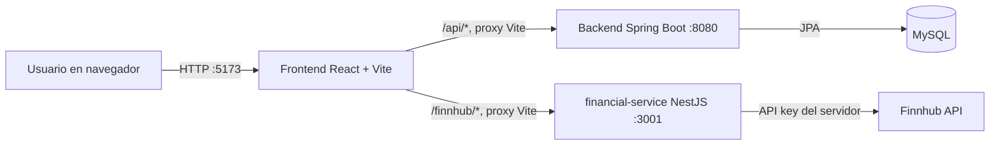

# Bckd Bank Frontend

Aplicación web para consultar y operar cuentas de Bckd Bank. La interfaz está construida con React, TypeScript y Vite, y se integra con el backend bancario Spring Boot y el microservicio financiero NestJS que consulta Finnhub.

## Arquitectura e integración



### Responsabilidad de cada proyecto

- **Frontend (`frontend/`)**: presenta el login/registro, las cuentas, saldos, movimientos, transferencias y datos de mercado. No contiene credenciales de Finnhub.
- **Backend Java (`Desarrollo Web - Electivo/bckdbank/`)**: autentica usuarios, emite JWT y administra cuentas e historial de transferencias en MySQL.
- **Microservicio NestJS (`financial-service/`)**: recibe las consultas bursátiles, agrega la API key de Finnhub, aplica caché en memoria y devuelve cotizaciones o perfiles.
- **Finnhub**: proveedor externo de los datos de mercado.

En desarrollo, el navegador solo solicita rutas al mismo origen de Vite. El proxy de Vite reenvía `/api/*` a Spring Boot y `/finnhub/*` al microservicio, lo que evita configurar CORS entre los tres puertos locales.

## Requisitos

- Node.js `20.19` o superior y npm.
- Java 17 o superior para el backend.
- MySQL 8 iniciado y configurado para el backend.
- Una API key de Finnhub configurada en `financial-service/.env`.

## Configuración

### Backend Java

Revisa `bckdbank/src/main/resources/application.yml` y configura las variables de conexión a MySQL. El backend usa por defecto el puerto `8080`.

### Microservicio Finnhub

En `financial-service/.env`, configura la clave real. No la copies al frontend ni la publiques en Git.

```env
PORT=3001
FINNHUB_API_KEY=tu_clave_de_finnhub
FINNHUB_BASE_URL=https://finnhub.io/api/v1
FINNHUB_CACHE_TTL_MS=60000
```

Consulta `financial-service/README.md` para los detalles de configuración de Finnhub.

### Frontend

El archivo `.env.example` documenta los destinos del proxy:

```env
VITE_BACKEND_URL=http://localhost:8080
VITE_FINANCIAL_SERVICE_URL=http://localhost:3001
```

No es necesario crear `.env.local` si usas los puertos predeterminados. Si cambias alguno, copia `.env.example` como `.env.local`, modifica la URL correspondiente y reinicia Vite. Las variables `VITE_*` se incluyen en el bundle del navegador; úsalas solo para URLs públicas, nunca para secretos.

## Arranque local

Inicia los tres procesos en terminales distintas. En Windows PowerShell:

### 1. MySQL y backend Java

Asegúrate de que MySQL esté iniciado. Luego:

```powershell
Set-Location "C:\Users\jean.montoyaca\Desktop\Daniel\Docencia\Desarrollo Web - Electivo\Desarrollo Web - Electivo\bckdbank"
.\mvnw.cmd spring-boot:run
```

El backend debe quedar disponible en `http://localhost:8080`.

### 2. Microservicio financiero

```powershell
Set-Location "C:\Users\jean.montoyaca\Desktop\Daniel\Docencia\Desarrollo Web - Electivo\financial-service"
npm install
npm run start:dev
```

El microservicio debe quedar disponible en `http://localhost:3001`. La API key tiene que estar configurada en su `.env`.

### 3. Frontend

```powershell
Set-Location "C:\Users\jean.montoyaca\Desktop\Daniel\Docencia\Desarrollo Web - Electivo\frontend"
npm install
npm run dev
```

Abre la URL que muestre Vite, normalmente `http://localhost:5173`. Mantén abiertas las tres terminales mientras pruebas la aplicación.

## Flujo de datos

### Acceso y datos bancarios

1. El frontend envía las credenciales a `POST /api/v1/auth/login` o los datos de registro a `POST /api/v1/auth/register`.
2. Spring Boot responde con `token`, `email` y `role`. El frontend conserva la sesión en `localStorage` bajo `bckdbank.session`.
3. Para consultar las cuentas, el frontend envía `GET /api/v1/accounts` con `Authorization: Bearer <token>`.
4. Por cada cuenta, consulta `GET /api/v1/transactions/account/{accountNumber}`, también autenticado.
5. Si Spring Boot devuelve `401` o `403`, la interfaz elimina la sesión y solicita volver a iniciar sesión.

### Transferencias

1. Abre **Transferir dinero** y elige la cuenta de origen.
2. Introduce el número completo de la cuenta destino, el importe y, si quieres, una descripción.
3. El frontend envía `POST /api/v1/transactions/transfer` con el token JWT y este JSON:

   ```json
   {
     "sourceAccountNumber": "100800012345",
     "destinationAccountNumber": "100800065432",
     "amount": 25.5,
     "description": "Pago de prueba"
   }
   ```

4. Si el backend acepta la operación, el frontend vuelve a cargar saldos e historial. La validación de propiedad de cuenta y saldo suficiente corresponde al backend.

Para probar una transferencia, registra dos usuarios. Usa el número completo de la cuenta creada para el segundo usuario como destino. El backend crea una cuenta de ahorros con saldo inicial de demostración al registrar un usuario.

### Datos de mercado

Después de iniciar sesión, la tarjeta de mercado consulta en paralelo:

- `GET /finnhub/quote?symbol=AAPL`: precio, variación, máximos, mínimos y cierre anterior.
- `GET /finnhub/profile?symbol=AAPL`: nombre, ticker, moneda, bolsa y perfil de compañía.

Para consultar otra compañía, escribe su símbolo en el buscador de la tarjeta, por ejemplo `MSFT`, y envía la búsqueda. Vite reenvía esas rutas a `financial-service`, que consulta Finnhub y mantiene las respuestas en caché según su configuración.

## Endpoints consumidos

| Proyecto | Método y ruta | Uso en el frontend |
| --- | --- | --- |
| Spring Boot | `POST /api/v1/auth/login` | Inicio de sesión y obtención del JWT |
| Spring Boot | `POST /api/v1/auth/register` | Registro de usuario |
| Spring Boot | `GET /api/v1/accounts` | Cuentas y saldos del usuario autenticado |
| Spring Boot | `GET /api/v1/transactions/account/{accountNumber}` | Historial de la cuenta autenticada |
| Spring Boot | `POST /api/v1/transactions/transfer` | Crear una transferencia autenticada |
| NestJS | `GET /finnhub/quote?symbol={symbol}` | Cotización bursátil |
| NestJS | `GET /finnhub/profile?symbol={symbol}` | Perfil de compañía |

## Pruebas manuales

- **Login**: inicia sesión con un usuario existente. La pantalla debe mostrar sus cuentas.
- **Registro**: crea un usuario nuevo desde la pestaña **Crear cuenta**. El backend debe devolver el token y crear su cuenta inicial.
- **Historial**: selecciona una cuenta y revisa sus movimientos recientes.
- **Transferencia**: registra dos usuarios y transfiere un importe positivo entre sus cuentas. Verifica el saldo y el historial después de la operación.
- **Finnhub**: busca `AAPL` en la tarjeta de mercado; revisa el precio, porcentaje de cambio y perfil.
- **Servicios detenidos**: si una API no responde, la interfaz muestra el error. Confirma que el servicio correspondiente siga ejecutándose y vuelve a intentar.

Puedes consultar directamente el microservicio en `http://localhost:3001/finnhub/quote?symbol=AAPL` y `http://localhost:3001/finnhub/profile?symbol=AAPL` para aislar un problema de Finnhub del frontend.

## Moneda y seguridad

El DTO de cuentas del backend no incluye la moneda. Por eso la interfaz muestra los saldos de cuenta como USD y no convierte valores. Las cotizaciones muestran la moneda que devuelve el perfil de Finnhub; no compares automáticamente esa cifra con los saldos bancarios.

El token JWT se guarda en `localStorage` para mantener la sesión al recargar. Cierra sesión en equipos compartidos. Para producción, evalúa una estrategia de almacenamiento de token más restrictiva y configura HTTPS, orígenes permitidos y un proxy inverso. No expongas la API key de Finnhub en el bundle del frontend.

## Calidad y build

Desde la carpeta `frontend`:

```powershell
npm run lint
npm run build
npm run preview
```

`npm run preview` sirve localmente el build de producción. En producción, configura un proxy inverso para `/api` y `/finnhub`, o permite explícitamente el origen del frontend en los backends.
